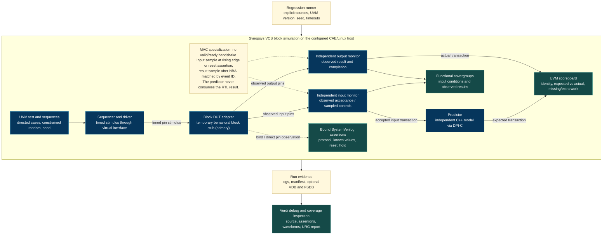

# Block verification environment, v0.1

Draft for [verification #3](https://github.com/SiliconBadgers/verification/issues/3)
and [#4](https://github.com/SiliconBadgers/verification/issues/4), October 5, 2026.
This branch starts a reusable UVM block environment with a onboarding signed MAC and
an independent C++ DPI-C predictor. The integration pilot uses the existing
command router and explicitly unimplemented engine fixtures. VCS/Verdi execution
on the team's licensed host is a required next evidence step, not a result
implied by these sources.

The [central Architecture diagram](https://github.com/SiliconBadgers/architecture/blob/main/docs/accelerator-diagram.md)
remains the system design reference. The diagram here describes the verification
environment around **one block**, not a competing accelerator architecture.
See the [test plan](../../plans/block-verification-v0.1.md) for source revisions,
open contracts and requirement IDs.


**Current primary example:** [tb/block](../../tb/block/README.md) mirrors the UART
training layout around made-up request/response signals and a behavioral stub.
`env_top`, `test_top`, `verif_pkg`, typed config and agent wiring remain familiar.
The MAC material below is optional onboarding/infrastructure evidence, not an
accelerator DUT. The shared topology applies to both; provisional signals must
be replaced with each block's agreed contract. The block stub observes valid/ready
acceptance before NBA; the MAC uses its separately documented clock/reset sampling.

## Block diagram

The editable source is [block-environment.mmd](block-environment.mmd). Keep this
rendered Markdown diagram consistent when editing the source.



VCS compiles, elaborates and executes the timed RTL/UVM simulation. Verdi is the
debug and coverage inspection application; it does not replace the simulation
or independent checker. Logs and a machine-readable result decide pass/fail.
Waveforms help explain a failure. Coverage databases describe exercised behavior;
they do not prove numerical correctness.

## What each repository contributes

| Repository and inspected baseline | Reuse | Adaptation required |
|---|---|---|
| `verification`, `91a35e0` | Independent integer smoke checker, malformed-vector rejection, bounded runtime; router test with explicit errors and backpressure | Add UVM composition, C++ model, assertion/coverage collection and a hardened VCS runner without losing error detection |
| `UVM_Library`, `33e85d8` | Accellera UVM 1.2 implementation, factory/configuration, sequences, analysis ports and source-build examples | Select exactly one UVM implementation per build; record its revision and compile its DPI sources when using source mode |
| `uvm-training`, `a207f23`, with `UVM_Library` at `33e85d8` | UART example of top/interface, config object, active agent, monitor, scoreboard and test phases | Its ModelSim `run/run.do` and UART protocol are training material; create VCS/Verdi commands and accelerator-specific transactions |

The training scoreboard preloads expected UART values from its test and pops
them on observation. It does not provide the accepted-input predictor, pending
work accounting or drain contract needed here. It also declares its `expected`
member using the observed analysis-implementation type and constructs only the
observed port. Treat it as a teaching example, not a production scoreboard to
copy unchanged. Fixed `#100us` end-of-test delay in the training test is replaced
by explicit checking and bounded completion.

Use the sibling `UVM_Library` source tree for a reproducible source-mode build. Do not
compile both that tree and `uvm-training/UVM_Library`, or mix either with VCS's
built-in UVM in one build. The supplied CAE handout uses VCS's UVM 1.2 selection;
use explicit `--uvm-mode vcs` for that baseline and `--uvm-mode source` when
validating the pinned library source. The training script's `UVM_NO_DPI`
setting is not a recipe for the new environment: the pilot deliberately uses
its own DPI-C numerical model, and source UVM has its own DPI build needs.

## Method by layer

| Layer | Chosen starting method and RTL connection | Independent reference / coverage | Synopsys role and alternative rationale |
|---|---|---|---|
| Small primitives: MAC, pack/unpack, conversion, reduction | Directed SV tasks plus assertions are sufficient for many isolated fixed interfaces. The MAC also provides the first UVM learning/reuse pilot | Exact arithmetic and exhaustive small encodings where feasible; boundaries, priority, reset and numerical events | VCS runs actual RTL, assertions and optional code coverage; Verdi inspects failures. UVM overhead is justified for this reusable pilot, not mandatory for every primitive |
| Reusable compute block with multiple command/data channels | UVM agents, constrained sequences, independent input/output monitors, predictor and scoreboard | C++ functional kernels plus contract-defined quantization; accepted transactions, operation/shape/format crosses and stalls | VCS executes RTL and DPI-C; Verdi connects transaction history to waveforms. A C++-only harness is useful for fast models but does not verify the timed RTL interface |
| Local and top-level controllers | Begin with small SV directed/property tests while the interface is changing; add reusable UVM command/status and memory agents as traffic grows | Abstract ownership/state model; invalid input, busy, identity, completion stability, error and drain assertions | VCS runs controller RTL with variable-latency stubs. A whole UVM SoC is unnecessary for the existing eight-command routing experiment |
| Memory and compute/control integration | UVM active request/response agents and passive monitors after acceptance and visibility contracts exist | Byte-addressed memory oracle, outstanding-ID/ownership ledger, masks/strides/tails; arbitration and backpressure crosses | VCS checks the actual shared RTL boundary and bound SVA; Verdi diagnoses request/response ordering. A transaction-level model explores assumptions but cannot establish RTL timing correctness |
| Accelerator/SoC and firmware boundary | Retain SoC's pinned C++/Verilator firmware harness; migrate a reviewed RTL boundary to VCS when feasible, reusing passive block agents | Software runtime reference, command/completion ledger and tensor comparisons; unsupported fallback, state isolation and visibility | VCS/Verdi feasibility must be demonstrated for selected wrappers and dependencies. Existing Verilator results are separate evidence; no claim of a VCS CPU or full-system port |
| Numerical policy and whole inference | Software reference and quantized candidate models, then selected RTL kernel comparisons and stateful chain tests | Checkpoint behavior, deliberate numerical approximation and bit-defined kernel references are three different oracles | Fast C++/Python models handle broad workload/quality studies; VCS verifies mapped RTL cases. CPU profiles and analytical resource sweeps are not hardware measurements |

## MAC pilot semantics and independence

The [MAC contract](https://github.com/SiliconBadgers/architecture/blob/81fdeae2d4d3facd3e88a0c06a7b577ed1a7d2e3/contracts/mac-v0.json)
defines signed 8-bit inputs, a 32-bit wrapping accumulator, clear before enable,
and active-low asynchronous reset. It does not define a ready/valid protocol.
An enabled cycle is arithmetic work; disabled, clear and reset events must also
be observed to check state. Calling every driver request an accepted hardware
transaction would hide a stalled or incorrectly driven interface.

The driver supplies timed controls through
[`sb_mac_if.sv`](../../tb/unit/mac/agent/sb_mac_if.sv). Independent monitors observe a
rising clock edge or falling reset edge. The input monitor captures controls
before nonblocking updates; the output monitor samples after settling. Each
uses event identity to let the scoreboard tolerate analysis-port callback order.
The short reset pulse between rising edges explicitly distinguishes asynchronous
reset from a synchronous-only implementation.

The predictor invokes [`mac_reference.cpp`](../../models/mac_reference.cpp) from
observed input transactions. The predictor holds a separate reference accumulator
and passes it to the C++ next-state function, which computes signed products
with explicitly defined 32-bit wrap. Neither obtains expected state from the
RTL accumulator or driver intentions. Different source
language alone does not establish independence: the contract, worked boundary
examples and standalone model checks must agree without copying the RTL's
expression sizing or overflow behavior. C++ signed-overflow undefined behavior
must not determine expected results.

[`sb_mac_pkg.sv`](../../tb/unit/mac/sb_mac_pkg.sv) contains the pilot composition
and tests, with shared checking infrastructure in
[`sb_uvm_base_pkg.sv`](../../tb/common/sb_uvm_base_pkg.sv);
[`sb_mac_assertions.sv`](../../tb/unit/mac/sb_mac_assertions.sv) checks
local pin behavior using `bind`. Expected/actual counts must be nonzero, matching
events must agree, and no pending expected or unexpected result may remain at
test end. The MAC has no external work to drain, so an observed reset is a new
zero-state check rather than permission to silently discard pending work.

Coverage samples observed controls/operands and observed output signs. The
predictor records arithmetic wrap transitions. Control combinations, signed
extremes, zero, reset and positive/negative wrap are targeted. A reached bin is
not proof that its checker fired correctly; mismatch and timeout injections
exercise the failure path. Coverage closure remains unmeasured until a licensed
run produces reviewed databases.

## Extending the base to a real block

Keep a reusable topology, then specialize transactions, interfaces and numerical
models to each agreed block contract. Do not publish a fictional generic
accelerator bus to make every candidate fit the MAC interface.

For ready/valid protocols, input monitors emit only on observed `valid && ready`.
The producer must retain payload while stalled. Distinguish these events:

1. **Accepted:** ownership transfers on the agreed handshake; an ID enters the
   outstanding ledger exactly once.
2. **Arithmetic complete:** the engine finishes its computation; output writes
   may still be outstanding.
3. **Visible:** the agreed response/fence point makes output/state observable to
   the consumer; only then may terminal completion permit dependent use or reuse.

Use IDs and reset/context epochs for reordered or pipelined blocks; keep the
latency model separate from the functional oracle. Timeout is a checker failure,
not a cancellation of an accepted transfer. Fault/reset tests stop new issue,
track outstanding responses, invalidate partial state according to the reviewed
contract and confirm quiescence before resource reuse. A reset does not justify
flushing the scoreboard's ownership ledger while live writes still exist.

Stateful blocks need a model per context with KV/recurrent/convolution state and
token position. Compare intermediate state as well as final tensors. Preserve
those models across command boundaries; reset or reuse them only at a specified
lifecycle transition. Compute1 and Compute2 each investigate the full operation
set independently; the same functional cases should evaluate both proposals
without presupposing four dedicated engines.

## VCS/Verdi execution and evidence

Use the maintained [runner guide](../../scripts/regression/README.md) for exact
commands, result schema and site setup. Representative invocations from the
`verification` repository on the licensed host are:

```sh
python3 scripts/regression/run_vcs.py --doctor
python3 scripts/regression/run_vcs.py --pilot mac --uvm-mode vcs --dry-run
python3 scripts/regression/run_vcs.py --pilot mac --uvm-mode vcs --test sb_mac_smoke_test --seed 1
python3 scripts/regression/run_vcs.py --pilot mac --uvm-mode vcs --test sb_mac_random_test --seed 17 --coverage --waves
python3 scripts/regression/run_vcs.py --pilot mac --uvm-mode vcs --test sb_mac_overflow_test --seed 1
python3 scripts/regression/run_vcs.py --pilot router --rtl-root ../rtl --soc-root ../soc
python3 scripts/regression/run_vcs.py --pilot mac --uvm-mode vcs --inject mismatch
python3 scripts/regression/run_vcs.py --pilot mac --uvm-mode vcs --inject timeout
python3 scripts/regression/run_vcs.py --pilot mac --uvm-mode source --uvm-root ../UVM_Library --test sb_mac_smoke_test
```

The two injection runs must fail for their intended reasons; a compiler or license error
is not evidence that mismatch/timeout detection works. Likewise, `--doctor`
or `--dry-run` does not establish license checkout or successful simulation.
The user-provided September 23, 2026 CAE handout reports VCS
`Y-2026.03_Full64`, Verdi `Y-2026.03` and URG `Y-2026.03`. Its environment starts
with `module load synopsys/suite` and `synopsys-run` in each terminal; see
[SETUP.md](../../SETUP.md) for the maintained CAE procedure and `VERDI_HOME`
configuration. These are **handout-reported baseline versions**, not versions
measured by running this branch. The handout's procedural register example with
a UVM import does not validate the class-based agent, DPI model or scoreboard.
Its observation that a fatal simulation may exit zero reinforces the need for
both an explicit pass marker and rejection of fatal/error diagnostics.

Do not embed CAE paths, license servers or credentials in Git. Establish the
supported VCS/Verdi pairing and C++ compiler locally; record versions and run
artifacts after actually invoking them. Optional FSDB and coverage support need
their site-specific integration and licenses verified, not guessed.

The first evidence package should contain the positive tests, independent model
checks, intentional wrong-result and timeout failures, missing-tool/setup failure,
the router's eight cases, source/contract revisions, seed, complete commands,
tool versions, logs and any coverage/debug limitations. Review a numerical
failure in Verdi and record that inspection separately from simulator success.
No aggregate coverage percentage or full-accelerator completion is claimed by
this initial branch.
